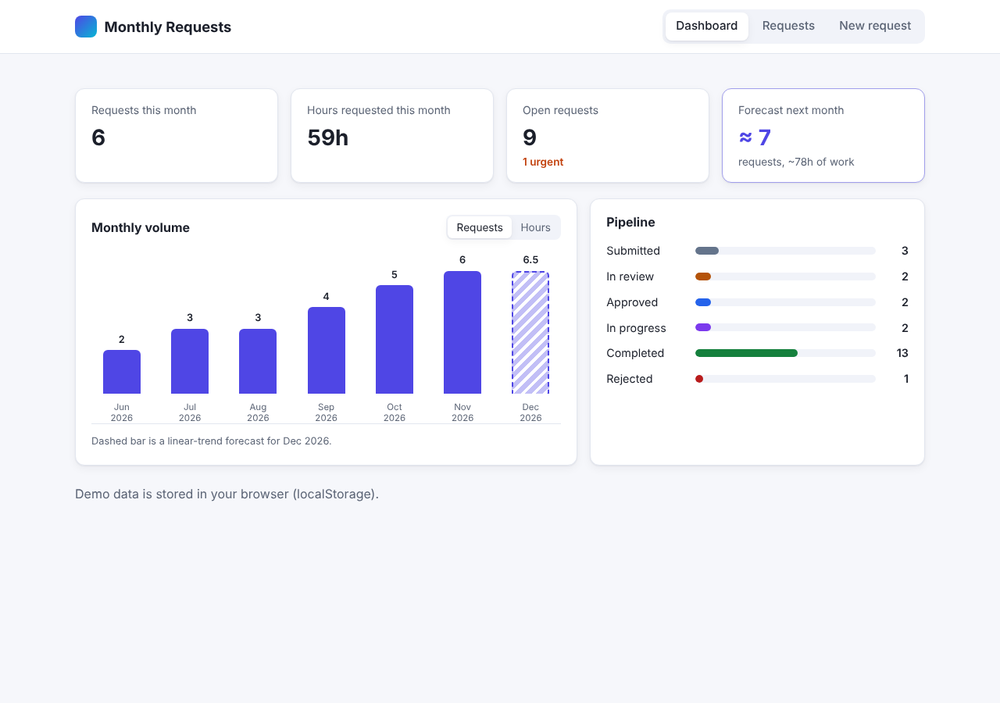
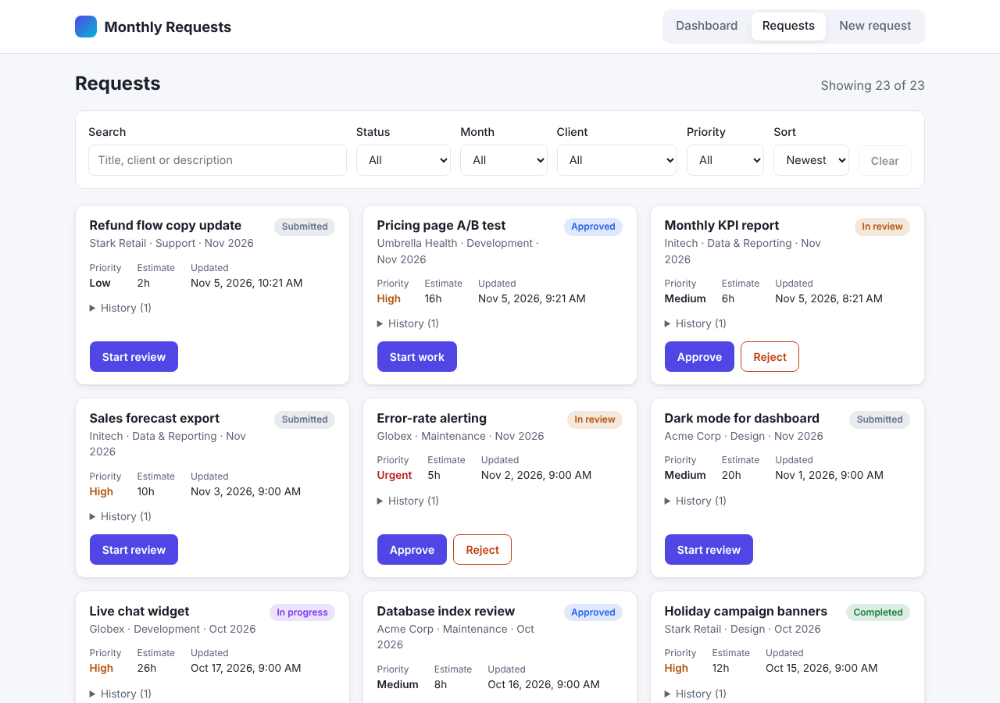
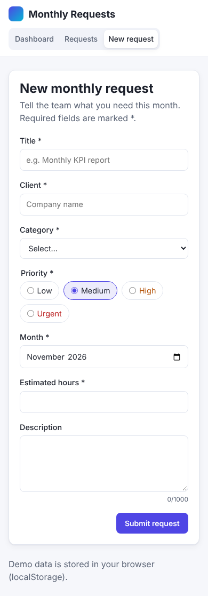

# 📅 Monthly Requests Platform

> Intake, review and delivery tracking for recurring client work, built with React and Redux Toolkit.

Clients raise service requests for a given month. The delivery team triages each one through a strict review pipeline, and a dashboard turns the history into totals, a status breakdown and a demand forecast for the coming month.

<p align="center">
  
</p>

---

## ✨ What it does

**Request intake.** A form with live, per-field validation. Errors from the API (HTTP 422) are mapped back onto the matching inputs, and network failures appear as a single banner.

**Review pipeline.** Each request follows one path:

```
submitted → in_review → approved → in_progress → completed
                 ↘ rejected → (resubmit) → submitted
```

These rules are defined once, as a finite-state machine in `src/domain/workflow.js`. The form buttons, the Redux thunks and the API all read from it, so a skipped step is impossible anywhere. The API rejects one with `409 Conflict`.

**Finding work.** Combine free-text search with status, month, client and priority filters, then sort by date, priority or effort. Results come from memoised selectors and recompute only when their inputs change.

**Insight.** Headline numbers for the current month, open and urgent work, a pipeline bar per status, and a six-month volume chart. The extra hatched bar is a least-squares forecast of next month's requests or hours.

**Swappable backend.** By default the app talks to an in-browser REST server that has realistic latency, status codes and `localStorage` persistence. Set `VITE_API_URL` and the same client calls a real service.

**Built for everyone.** Landmark elements, a skip link, labelled controls, polite live regions, visible focus, light and dark themes, reduced-motion support, and layouts from 360 px phones up to wide desktops.

| Request board | Submitting on a phone |
| :---: | :---: |
|  |  |

---

## 🔧 Technical highlights

| Area | How it's done |
| --- | --- |
| UI and state | React 19 with hooks only. Redux Toolkit slices, `createAsyncThunk` and `createEntityAdapter` keep data flowing one way, Flux style |
| Analytics | `src/domain/analytics.js` aggregates in a single pass, fills empty months, and fits an ordinary-least-squares trend to forecast demand |
| Architecture | Business rules live in pure modules, and the API client is injected through the thunk `extraArgument`, so it can be replaced or faked |
| Quality | 49 tests across the domain, API, store and component layers (Vitest and Testing Library), plus CI on every push |
| Modern JavaScript, CSS and HTML | Modules, destructuring, spread, `async`/`await`, optional chaining, `structuredClone`. Custom properties, grid, `color-mix()`, `:has()`. Semantic HTML5 markup |
| Performance | `React.memo`, memoised selectors, and a hand-rolled chart that keeps the bundle near 90 kB gzipped |
| Data structures | `Map` buckets, `Set` de-duplication, a normalised entity store, frozen enum objects |
| Deployment | Multi-stage Docker image (tests, then build, then nginx) launched with one command |

---

## 🚀 Run it locally

You need Node.js 20 or newer.

```bash
npm install        # install dependencies
npm run dev        # start the dev server on http://localhost:5173
npm test           # run all tests once
npm run build      # create an optimised build in dist/
npm run preview    # serve that build locally
```

To deploy with Docker in one command, see the [self-hosting guide](#-self-hosting-guide).

On first launch the app seeds six months of sample requests into `localStorage`. Clear the site's storage to start over.

### Connecting a real API

Create `.env.local` containing:

```
VITE_API_URL=https://api.example.com
```

The backend must implement the five routes listed at the top of `src/api/mockServer.js`.

---

## 🐳 Self-hosting guide

Run your own copy on a laptop, a home server or a VPS.

### Option A: Docker (one command)

Requirements: [Docker](https://docs.docker.com/get-docker/) with the Compose plugin (bundled with Docker Desktop).

```bash
git clone https://github.com/Khalil002/monthly-requests.git
cd monthly-requests
docker compose up -d --build
```

Then open **http://localhost:8080**.

The image is built in two stages. The first stage installs dependencies, **runs the test suite** and compiles the app, so a broken build never ships. The second stage serves the static output from nginx, with gzip, long-lived caching for hashed assets, and a fallback to `index.html`.

| Task | Command |
| --- | --- |
| Use another port | `PORT=3000 docker compose up -d --build` |
| Point at a real backend | `VITE_API_URL=https://api.example.com docker compose up -d --build` |
| View logs | `docker compose logs -f` |
| Check health | `docker ps` shows `(healthy)` once nginx responds |
| Update to the latest code | `git pull && docker compose up -d --build` |
| Stop and remove | `docker compose down` |

You can also set `PORT` and `VITE_API_URL` in a `.env` file next to `docker-compose.yml` instead of on the command line. Because `VITE_API_URL` is baked in at build time, rebuild after you change it.

Without Compose, the same thing takes two commands:

```bash
docker build -t monthly-requests .
docker run -d --name monthly-requests -p 8080:80 --restart unless-stopped monthly-requests
```

### Option B: Node.js only

Requirements: Node.js 20 or newer.

```bash
git clone https://github.com/Khalil002/monthly-requests.git
cd monthly-requests
npm ci
npm run build
npm run preview -- --host --port 8080
```

`npm run build` writes plain static files to `dist/`. For a long-running setup, serve that folder from any web server (nginx, Caddy, Apache) and route unknown paths to `index.html`. The bundled `nginx.conf` is a ready-made example.

### Troubleshooting

- **Port already in use**: choose another with `PORT=<number>`.
- **Old data still showing**: requests live in your browser's `localStorage`, so clear site data for the host to reseed.
- **Build fails at `npm test`**: a test is red. Run `npm test` locally to see which one.
- **Behind a corporate proxy**: pass it into the build with `docker compose build --build-arg HTTPS_PROXY=$HTTPS_PROXY`.

---

## 🗂️ Code layout

| Folder | Responsibility |
| --- | --- |
| `src/domain/` | Framework-free rules: workflow state machine, validation, analytics |
| `src/api/` | Mock REST server, seed generator, HTTP client |
| `src/store/` | Store factory, slices, memoised selectors |
| `src/components/` | Dashboard, chart, filter bar, request cards, submission form |
| `src/hooks/` | `useHashView`, a dependency-free hash router |
| `src/test/` | Global test setup and a render-with-store helper |

## 🧰 Stack

React 19 · Redux Toolkit 2 · React Redux 9 · Vite 7 · Vitest 3 · Testing Library · vanilla CSS

## 📄 License

Released under the [MIT License](LICENSE).
